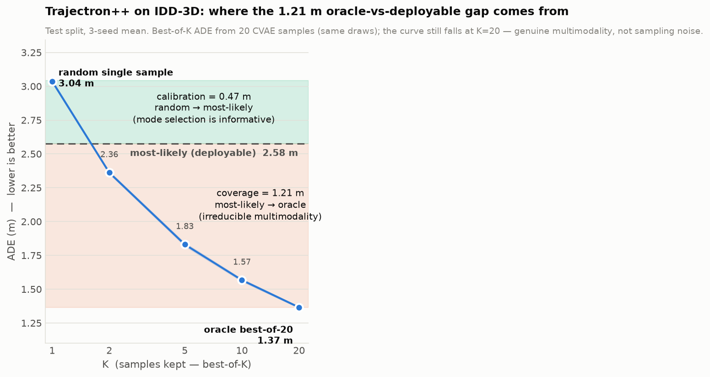
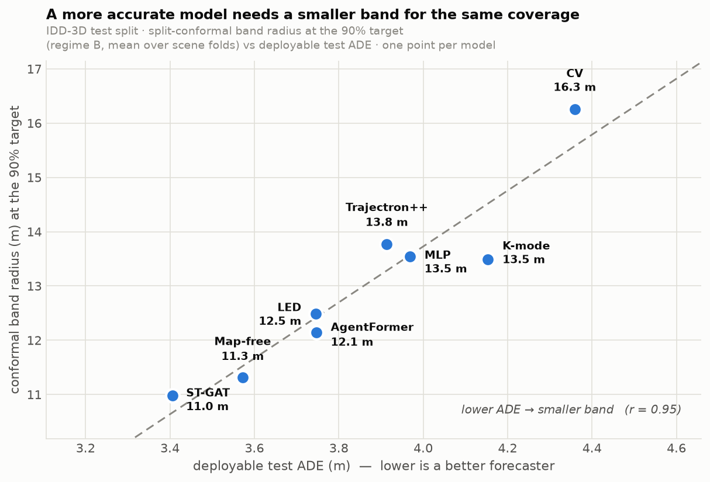
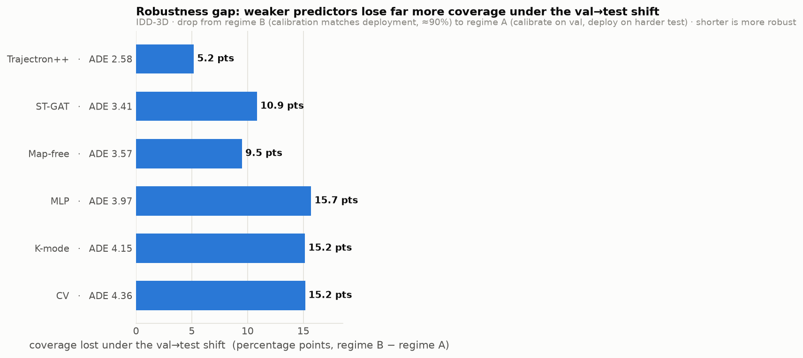
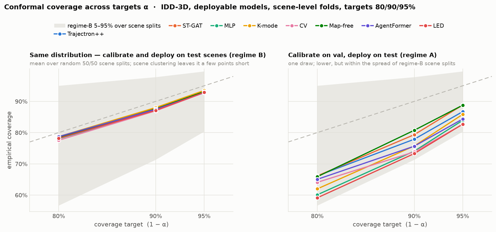

# DreamDrive — Trajectory Prediction on IDD-3D (Chaotic Mixed Traffic)

Multi-future trajectory prediction for unstructured Indian traffic, benchmarked on the
[IDD-3D](https://idd3d.github.io/) dataset (105 scenes, 10 fps, 25 agent classes).
Observation window 2.0 s (20 frames) → prediction horizon 6.0 s (60 frames), `dt = 0.1 s`.

**Capstone project PW26_CGM_04** — Idhant Singh, Rishav Ghosh, Shagal Verma, Shourya Rai (PES University).

---

## Results integrity policy

Every number in the results tables below is generated from a committed metrics JSON by
[`scripts/make_tables.py`](scripts/make_tables.py); CI fails if a table is hand-edited
(`python scripts/make_tables.py --check`). A result without an artifact does not appear here.

**Retractions (July 2026).** Earlier versions of this repository and the Phase-2 report
contained results that were not backed by any experiment artifact, including a claimed
66%/131% ADE/FDE degradation of Trajectron++ on collision data (a placeholder — the
experiment was never run), a benchmark table whose values matched no artifact, and a
Trajectron++ "correction" that divided metrics by 10 without a new evaluation. All are
retracted; see `research/report.txt` §7.2–7.3 for the retraction text.

## The ego-motion correction (read this first)

Raw IDD-3D labels store `psr.position` in the **per-frame ego/LiDAR frame**. Uncompensated,
every trajectory mixes agent motion with ego motion — median apparent *pedestrian* speed was
**5.05 m/s** (impossible). [`scripts/0_compensate_ego_motion.py`](scripts/0_compensate_ego_motion.py)
estimates per-frame SE(2) ego motion from the annotations themselves (RANSAC rigid alignment;
static objects such as parked vehicles are the inliers) and re-expresses all positions in a
per-scene world frame. After compensation the median pedestrian speed is **0.91 m/s**
(walking pace). Diagnostics: [`outputs/ego_compensation_stats.json`](outputs/ego_compensation_stats.json);
regression tests: [`tests/test_speed_sanity.py`](tests/test_speed_sanity.py).

Consequences:

- All **legacy ego-frame results are deprecated** (kept below for the record only). They are
  not comparable to any published benchmark, and part of the learned models' apparent
  advantage in that frame came from implicitly learning ego motion.
- The compensation is an approximation pending official ego poses / LiDAR odometry
  (raw `.pcd` files are not in this repo). Fallback statistics are recorded per scene.

## Pipeline

```
IDD-3D label JSONs (per-frame, ego-relative)
  │ 1_parse_idd3d_positions.py         → outputs/parsed_positions/*.csv        (ego frame)
  │ 0_compensate_ego_motion.py         → outputs/parsed_positions_world/*.csv  (world frame)
  │ 2_consolidate_trajectories.py      → outputs/trajectories_world/trajectories.csv
  │ 3_make_windows_obs20_pred60.py     → outputs/windows_world_obs20_pred60.npz     (4,820 windows)
  │ 4_export_multiagent_trajpp_format.py → outputs/multiagent_world_v1/scenes/*.npz (105 scenes)
  │ 5_export_stgat_format.py           → outputs/stgat_dataset_world_obs20_pred60.npz (608 seqs, 4,443 agents)
  │ 6_export_trajectronpp_world.py     → outputs/trajectronpp_world/{train,val}.pkl  (dt=0.1)
  └ models: model1 (CV) · model2 (MLP) · model3 (ST-GAT-inspired) · model4 (K-mode decoder)
            7_train_eval_trajectronpp.py (upstream Trajectron++)
```

## Results — Benchmark v2 (canonical dataset, frozen test set)

The current headline benchmark. Protocol:

- **Data:** [`outputs/canonical_world_obs20_pred60.npz`](outputs/canonical_world_obs20_pred60_stats.json)
  — world-frame, 718 sequences, **10,576 agents** (the legacy all-80-frames survivor filter
  discarded 58% of predictable agents; agents now need only a full 2 s observation + ≥1 future
  step, with per-timestep `fut_mask`). All five models evaluate on this same population.
- **Split:** frozen [`splits/scene_splits.json`](splits/scene_splits.json) (73/10/22 scenes,
  hash-based, committed). Model selection uses val only; **test numbers are final**.
- **Seeds:** {0,1,2} affect model init/shuffling only, never the split. Cells are mean ± std.
- **Metrics:** masked ADE over valid future steps; FDE at each agent's last valid step;
  sum-and-divide aggregation. Oracle rows select the best mode *after seeing ground truth* —
  upper bounds, never comparable with deployable rows.

<!-- BEGIN AUTOGENERATED: benchmark v2 results (scripts/make_tables.py) -->
| Model | K | Deployable single output? | Test ADE (m) | Test FDE (m) | Val ADE (m) | Seeds |
| --- | --- | --- | --- | --- | --- | --- |
| CV (vel_k=5) | 1 | yes | 4.36 | 9.78 | 2.43 | 0 |
| MLP | 1 | yes | 3.97 ± 0.01 | 8.66 ± 0.05 | 2.31 ± 0.01 | 0,1,2 |
| ST-GAT-inspired (MHA) | 1 | yes | 3.41 ± 0.07 | 7.35 ± 0.16 | 2.38 ± 0.03 | 0,1,2 |
| K-mode decoder — oracle best-of-10 | 10 | no (oracle) | 1.88 ± 0.05 | 3.18 ± 0.11 | 1.32 ± 0.03 | 0,1,2 |
| K-mode decoder — learned top-1 | 10 | yes | 4.31 ± 0.05 | 9.48 ± 0.24 | 3.38 ± 0.36 | 0,1,2 |
| K-mode decoder (top-1-selected) — oracle best-of-10 | 10 | no (oracle) | 2.01 ± 0.07 | 3.56 ± 0.19 | 1.69 ± 0.09 | 0,1,2 |
| K-mode decoder (top-1-selected) — learned top-1 | 10 | yes | 4.15 ± 0.10 | 9.21 ± 0.26 | 2.61 ± 0.13 | 0,1,2 |
| Trajectron++ — most-likely | 1 | yes | 2.58 ± 0.04 | 5.58 ± 0.07 | 2.14 ± 0.07 | 0,1,2 |
| Trajectron++ — oracle best-of-20 | 20 | no (oracle) | 1.37 ± 0.01 | 2.39 ± 0.02 | 1.10 ± 0.02 | 0,1,2 |
| Trajectron++ hetero (unicycle) — most-likely | 1 | yes | 2.84 ± 0.09 | 6.45 ± 0.27 | 2.21 ± 0.08 | 0,1,2 |
| Trajectron++ hetero (unicycle) — oracle best-of-20 | 20 | no (oracle) | 1.37 ± 0.04 | 2.49 ± 0.05 | 1.00 ± 0.02 | 0,1,2 |

Source artifact: [`outputs/benchmark_v2/summary.json`](outputs/benchmark_v2/summary.json) (aggregated from per-seed metrics JSONs in the same directory).
<!-- END AUTOGENERATED: benchmark v2 results -->

### Per-class fairness audit (test split)

Per-IDD-3D-class error for the best deployable model. `ADE per path-meter` normalizes by how
far the agent actually travels, so fast classes aren't trivially "worse".

<!-- BEGIN AUTOGENERATED: per-class audit (scripts/make_tables.py) -->
Best deployable model on test: **Trajectron++ — most-likely** (per-class stats from one representative seed).
Note: Trajectron++ is evaluated at every valid timestep, so `n` counts node@timestep prediction instances — denser than the one-window-per-agent counts of the other models, but over the same test scenes.

| Class | n | ADE (m) | FDE (m) | Mean GT path (m) | ADE per path-meter |
| --- | --- | --- | --- | --- | --- |
| MotorcyleRider | 4000 | 3.20 | 7.01 | 19.5 | 0.164 |
| Pedestrian | 3915 | 0.76 | 1.49 | 3.1 | 0.245 |
| ScooterRider | 3632 | 3.43 | 7.45 | 18.6 | 0.184 |
| Car | 3402 | 4.08 | 9.17 | 17.5 | 0.233 |
| Truck | 2979 | 2.20 | 4.68 | 8.2 | 0.269 |
| TourCar | 2934 | 3.21 | 6.61 | 13.7 | 0.235 |
| Scooter | 554 | 0.60 | 1.28 | 1.9 | 0.313 |
| Motorcycle | 541 | 0.82 | 1.70 | 2.2 | 0.372 |
| Unknown | 464 | 0.42 | 0.84 | 2.6 | 0.157 |
| Misc | 256 | 0.38 | 0.51 | 2.8 | 0.138 |
| Bus | 241 | 2.67 | 5.56 | 8.3 | 0.320 |
| Van | 224 | 0.56 | 1.04 | 4.2 | 0.134 |
| Animal | 159 | 0.25 | 0.40 | 1.1 | 0.233 |
| PoliceCar | 123 | 2.19 | 3.84 | 4.0 | 0.548 |
| Unknown1 | 69 | 0.71 | 1.38 | 1.6 | 0.446 |

ADE disparity (worst/best class, n ≥ 50): **16.05×**
<!-- END AUTOGENERATED: per-class audit -->

### Where the oracle-vs-deployable gap comes from (Trajectron++)

Trajectron++'s 1.21 m gap between most-likely (2.58) and oracle best-of-20 (1.37) is *not* a
selection failure. A best-of-K sweep + mean-over-samples readout (same 20 draws, no extra
compute; [`scripts/7_train_eval_trajectronpp.py`](scripts/7_train_eval_trajectronpp.py)
`sampling_curve`) splits it into a calibration slice and a coverage slice:



*(Regenerate from the artifact: `python scripts/plot_gap_decomposition.py`.)*

<!-- BEGIN AUTOGENERATED: trajectronpp gap decomposition (scripts/make_tables.py) -->
| Readout | Test ADE (m) | Meaning |
| --- | --- | --- |
| Random single sample (best-of-1 ≈ mean-sample) | 3.04 | one draw, blind |
| **Most-likely (deployable)** | **2.58** | argmax latent + GMM mode |
| Oracle best-of-20 | 1.37 | min over samples, picked in hindsight |

Best-of-K curve (K = 1, 2, 5, 10, 20): **3.04 → 2.36 → 1.83 → 1.57 → 1.37**.

- **Calibration value = 0.47 m** (random draw → most-likely): the deployable mode beats a random sample — the mode selection is genuinely informative.
- **Coverage value = 1.21 m** (most-likely → oracle): the irreducible cost of committing to one future. The curve is still falling at the largest K, the signature of genuine multimodality rather than sampling noise — only multiple deployed modes can close it.

Source artifact: [`outputs/benchmark_v2/summary.json`](outputs/benchmark_v2/summary.json) (`trajectronpp_gap_decomposition`, 3-seed test mean).
<!-- END AUTOGENERATED: trajectronpp gap decomposition -->

### Calibrated uncertainty bands (split-conformal wrapper)

A post-hoc wrapper ([`scripts/conformal_wrapper.py`](scripts/conformal_wrapper.py)) turns each
deployable point predictor into a per-timestep uncertainty band with a distribution-free
coverage guarantee. Nonconformity is the per-step position error; the frozen splits make the
calibration statistically clean. The wrapper covers **all five deployable predictors** — CV and
MLP reproduced in numpy, the neural three (K-mode top-1, ST-GAT, Trajectron++ most-likely) fed
from prediction dumps ([`scripts/dump_predictions.py`](scripts/dump_predictions.py) and script 7
`--dump-preds`). Four findings (α = 0.1, 90% target; artifact
[`outputs/benchmark_v2/conformal_metrics.json`](outputs/benchmark_v2/conformal_metrics.json)):

| Predictor | Regime B — test-fold | Regime A — val→test | band radius |
|---|---|---|---|
| CV (vel_k=5) | 89.0% | 73.8% | 15.9 m |
| MLP | 89.8% | 74.1% | 13.8 m |
| K-mode (top-1) | 90.9% | 75.7% | 13.8 m |
| ST-GAT (MHA) | 90.2% | 79.3% | 10.8 m |
| Trajectron++ (most-likely) | 89.9% | 84.8% | 10.0 m |

1. **The method is sound when calibration matches deployment.** Split-conformal *within* the
   test set (seeded 50/50 fold) hits the 90% target for **every** model (89.0–90.9%, col 1) —
   the implementation is correct across all five.
2. **Naïve conformal fails under the val→test shift (honest, important).** Calibrated on val
   and deployed on the harder test split, coverage collapses for all five (col 2). The same
   distribution shift the frozen test set exposed (test is 1.2–1.8× harder than val) breaks
   conformal's exchangeability assumption. A deployed system must calibrate on data drawn like
   deployment, not on an easier split.
3. **Stronger predictors survive the shift better.** Regime-A coverage rises monotonically with
   base-model accuracy — CV 73.8% → MLP 74.1% → K-mode 75.7% → ST-GAT 79.3% → Trajectron++
   84.8% — and the band tightens in step (15.9→10.0 m). A more accurate predictor has a smaller
   val→test error gap, so the exchangeability violation bites less: Trajectron++ loses only 5
   points where CV loses 15. Calibrated uncertainty is one more thing a better forecaster buys.
4. **One global radius is per-class unfair; class-conditional radii fix it** (shown for CV; one
   figure per model in `outputs/benchmark_v2/conformal_coverage_*.png`). A single radius
   under-covers fast classes (Car 78%) and over-covers slow ones (Pedestrian 96%) — a safety
   *and* efficiency failure. Per-IDD-3D-class radii pull each class toward nominal: Car
   78→91% (band widened 16→27 m, as it should be), Pedestrian 96→89% (band **halved**,
   11.7→5.6 m). This class-conditioning is motivated directly by the 16× per-class error
   disparity and is, for chaotic mixed traffic, the genuinely novel piece.

Findings 2–3 as pictures — the accuracy→uncertainty link across the five deployable models:



At a fixed 90% coverage target the band radius *is* uncertainty efficiency, and it tracks
accuracy almost linearly (r = 0.94): Trajectron++ certifies each position to ±10.0 m where CV
needs ±15.9 m for the same guarantee.



The shift-induced coverage loss (regime B − regime A) shrinks from 15+ points for the weak
predictors to just 5.2 for Trajectron++ — a stronger forecaster is not only tighter but more
robust to the calibration→deployment shift.

*(Regenerate: `python scripts/conformal_wrapper.py && python scripts/plot_conformal_coverage.py &&
python scripts/plot_uncertainty_efficiency.py`. Bands are wide because they wrap weak 6 s
predictors — the absolute width reflects the base model's accuracy; the finding is about relative
calibration and fairness.)*

**Robustness to the coverage target (α).** Everything above is the α = 0.1 (90%) operating point —
a conventional reporting default and a tunable knob (`--alpha`), *not* a safety-derived spec. Re-running
the whole evaluation at **80% / 90% / 95%** (α = 0.2 / 0.1 / 0.05;
[`scripts/conformal_alpha_sensitivity.py`](scripts/conformal_alpha_sensitivity.py) →
[`conformal_sensitivity.json`](outputs/benchmark_v2/conformal_sensitivity.json)) shows the findings are
not artifacts of the 90% choice:



Empirical coverage at each target (**B** = regime B, seeded test-fold, *valid*; **A** = regime A,
val→test, *deployed*):

| Model | B @ 80% | A @ 80% | B @ 90% | A @ 90% | B @ 95% | A @ 95% |
| --- | --- | --- | --- | --- | --- | --- |
| Trajectron++ | 79.4% | 71.7% | 89.9% | 84.8% | 95.1% | 92.1% |
| ST-GAT | 78.0% | 66.1% | 90.2% | 79.3% | 96.0% | 88.8% |
| MLP | 76.8% | 60.1% | 89.8% | 74.1% | 95.4% | 83.9% |
| K-mode | 80.0% | 62.0% | 90.9% | 75.7% | 95.4% | 85.9% |
| CV | 77.3% | 64.1% | 89.0% | 73.8% | 95.2% | 82.7% |

Source: [`outputs/benchmark_v2/conformal_sensitivity.json`](outputs/benchmark_v2/conformal_sensitivity.json).
At every target, regime B (calibration matches deployment) hits it — validity holds; regime A (val→test
shift) under-covers; and the two strong models (Trajectron++, ST-GAT) stay clearly closer to the target
than the weak three. The choice of α moves the absolute coverage and band width, not the qualitative
story. *(Regenerate: `python scripts/conformal_alpha_sensitivity.py`.)*

### Honest takeaways (Benchmark v2)

1. **Trajectron++ most-likely is the best deployable model** — test ADE 2.58 ± 0.04 /
   FDE 5.58 ± 0.07, clearly ahead of ST-GAT (3.41 / 7.35), MLP (3.97 / 8.66) and CV
   (4.36 / 9.78). Its eval is denser (every valid timestep) but covers the same frozen
   test scenes.
2. **Interaction modeling earns its keep on the full population.** In v1 (survivor-filtered
   data) the ST-GAT-inspired model lost to smoothed constant velocity; on the canonical
   dataset — which restores the 58% of agents the old filter discarded — it is the best
   homegrown model and beats MLP and CV by a clear margin.
3. **Mode selection, not mode diversity, remains the bottleneck.** The K-mode decoder's
   oracle best-of-10 (test ADE 1.88) is competitive with Trajectron++'s oracle (1.37), but
   its learned top-1 (4.31) is *worse than constant velocity's FDE-matched profile* and has
   the largest seed variance in the table (val ADE ± 0.36). Trajectron++'s most-likely-mode
   decoding shows the selection problem is solvable.
4. **The frozen test split is genuinely harder than val** (every model's test ADE is
   1.2–1.8× its val ADE). v1's val-only numbers were systematically optimistic — this gap
   is exactly what the frozen test set was created to expose.
5. **Raw errors concentrate on fast two-wheeler riders and cars, but normalization flips the
   story.** Per-class ADE is highest for MotorcyleRider / ScooterRider / Car / TourCar
   (3.2–4.1 m) and lowest for pedestrians (< 1 m) — yet per meter actually traveled,
   pedestrians err *more* (0.245 ADE/path-m) than motorcycle riders (0.164). The raw gap
   mostly tracks path length; relative to how far they move, erratic slow agents remain
   the hard case.
6. **The K-mode decoder's "mode-selection problem" was partly a checkpoint-selection
   artifact.** The original pipeline selected the saved checkpoint by val *oracle* ADE, then
   reported that same checkpoint's top-1 — but the best epoch for coverage isn't the best
   epoch for the classifier. Selecting on val top-1 ADE instead (same architecture, same
   loss) improves deployable test ADE from 4.31 ± 0.05 to 4.15 ± 0.10 and sharply stabilizes
   it across seeds (val ADE std 0.36 → 0.09), at the honest cost of worse oracle coverage
   (test 1.88 → 2.01, val 1.32 → 1.69 — a real trade-off, not free).
   **EWTA annealing did not help further (second honest negative result).** A val-only grid
   (seed 0, 150 epochs) compared plain WTA-with-top-1-selection against evolving-WTA variants
   (winner set annealed 10→1 over training, with hard or soft mode-classification targets):
   plain WTA won outright (val top-1 ADE 2.46 vs 2.60 hard-EWTA vs 2.76 soft-EWTA), so no
   EWTA variant was carried to the final 3-seed run. Even after both fixes, the K-mode
   decoder's top-1 remains well behind ST-GAT (3.41) — mode selection is improved, not solved.
   **A content-aware scorer also did not help (third negative result), and the reason is
   the interesting part.** We rebuilt the mode-scoring head to rank each mode from its
   *decoded trajectory* (endpoint, waypoints, path length, heading) rather than from context
   only — a unit test confirms it genuinely reads the trajectory (perturbing one mode's path
   moves only that mode's logit). On the val gate it was a wash (val top-1 ADE 2.51 vs the
   2.46 context-only baseline, within seed noise), so it was not promoted to a 3-seed run.
   The mechanism explains why: this decoder is *deterministic*, so each mode's trajectory is
   a fixed function of the per-mode context state the scorer already used — the trajectory
   features are redundant, not new information. The classifier was never information-starved;
   the bottleneck is the winner-takes-all *assignment target* itself. That points the next
   attack at the objective/structure (jointly-trained mixture density, or anchor/goal modes),
   not the scorer's input. Grid + per-seed artifacts:
   [`outputs/benchmark_v2/mfp_ewta_grid/`](outputs/benchmark_v2/mfp_ewta_grid/),
   [`outputs/benchmark_v2/mfp_content_grid/`](outputs/benchmark_v2/mfp_content_grid/),
   `mfp_top1sel_seed*.json`.
7. **Unicycle dynamics with approximate heading do not pay off (honest negative result).**
   Modeling wheeled classes as VEHICLE nodes with Unicycle dynamics (nuScenes-style; heading
   derived from velocity direction since IDD-3D yaw isn't in this repo's parsed data) plus
   rotation augmentation — selected over no-aug on val (2.12 vs 2.26) — *degrades* deployable
   most-likely on test (2.84 ± 0.09 vs 2.58 ± 0.04) with the loss concentrated exactly on
   moving vehicles (riders +0.6 m, cars +0.5 m; pedestrians unchanged), while oracle coverage
   is a wash (1.37 ± 0.04 vs 1.37 ± 0.01; val 1.00 vs 1.09). Reading: the unicycle integrates
   heading-estimate noise into its deterministic rollout, which sampling absorbs but
   most-likely decoding cannot. True yaw (raw dataset / perception) is the prerequisite for
   dynamics-aware modeling to help here. Grid + per-seed artifacts:
   [`outputs/benchmark_v2/tpp_hetero_grid/`](outputs/benchmark_v2/tpp_hetero_grid/),
   `trajectronpp_hetero_seed*.json`.

## Results — world frame v1 (superseded by Benchmark v2)

⚠️ Superseded: no test set (selection and reporting shared the val split), two different eval
populations (CV/MLP on single-agent windows vs. interaction models on multi-agent sequences),
survivor-biased agent filter, single seeds. Kept for the record; numbers below are val-only.

<!-- BEGIN AUTOGENERATED: world-frame results (scripts/make_tables.py) -->
| Model | Eval set | K | Deployable single output? | Val ADE (m) | Val FDE (m) | Artifact |
| --- | --- | --- | --- | --- | --- | --- |
| CV (vel_k=1) | windows val | 1 | yes | 6.27 | 13.81 | [`outputs/baselines_world/cv_velk1_metrics_world_obs20_pred60.json`](outputs/baselines_world/cv_velk1_metrics_world_obs20_pred60.json) |
| CV (vel_k=5) | windows val | 1 | yes | 4.82 | 11.20 | [`outputs/baselines_world/cv_velk5_metrics_world_obs20_pred60.json`](outputs/baselines_world/cv_velk5_metrics_world_obs20_pred60.json) |
| MLP | windows val | 1 | yes | 4.56 | 10.25 | [`outputs/baselines_world/mlp_metrics_world_obs20_pred60.json`](outputs/baselines_world/mlp_metrics_world_obs20_pred60.json) |
| ST-GAT-inspired (MHA) | multi-agent val | 1 | yes | 6.41 | 13.40 | [`outputs/baselines_world/stgat_mha_metrics_world_obs20_pred60.json`](outputs/baselines_world/stgat_mha_metrics_world_obs20_pred60.json) |
| K-mode variety decoder — oracle best-of-K | multi-agent val | 10 | no (oracle) | 3.66 | 6.12 | [`outputs/baselines_world/mfp_k10_metrics_world_obs20_pred60.json`](outputs/baselines_world/mfp_k10_metrics_world_obs20_pred60.json) |
| K-mode variety decoder — learned top-1 | multi-agent val | 10 | yes | 7.70 | 15.66 | [`outputs/baselines_world/mfp_k10_metrics_world_obs20_pred60.json`](outputs/baselines_world/mfp_k10_metrics_world_obs20_pred60.json) |
| Trajectron++ — most-likely (K=1) | multi-agent val | 1 | yes | 3.99 | 8.72 | [`outputs/baselines_world/trajectronpp_metrics_world_obs20_pred60.json`](outputs/baselines_world/trajectronpp_metrics_world_obs20_pred60.json) |
| Trajectron++ — best-of-20 | multi-agent val | 20 | no (oracle) | 1.79 | 2.97 | [`outputs/baselines_world/trajectronpp_metrics_world_obs20_pred60.json`](outputs/baselines_world/trajectronpp_metrics_world_obs20_pred60.json) |
<!-- END AUTOGENERATED: world-frame results -->

Honest takeaways from v1 (kept for the record; superseded by the Benchmark v2 section above):

1. **Oracle multi-future coverage helps a lot** — Trajectron++ best-of-20 (ADE 1.79) and the
   K-mode decoder's best-of-10 (ADE 3.66) both beat every single-output model. The
   multi-future premise of the project survives the frame correction.
2. **Trajectron++ most-likely is the best deployable model** (ADE 3.99 / FDE 8.72), ahead of
   the plain MLP (4.56 / 10.25). Note its evaluation population differs slightly (node-timesteps
   with full 1.9 s history + 6 s future, n=3,491) from the other rows.
3. **The homegrown interaction model lost its edge in the world frame.** The ST-GAT-inspired
   model no longer beats smoothed constant velocity; its ego-frame advantage was substantially
   an artifact of learning ego motion.
4. **Learned top-1 mode selection needs rework** — it degrades badly in the world frame
   (7.70 ADE vs. 3.66 oracle), while Trajectron++'s most-likely-mode decoding shows a
   deployable multi-modal model is achievable on this data.

## Results — legacy ego frame (deprecated, for the record)

⚠️ Ego-motion-contaminated data; kept only to document the project's history. Do not cite.
Additional protocol flaws: CV rows are evaluated on *all* windows (train+val); MLP and
ST-GAT v1/v2 use split seed 42 while v4/v5 and the K-mode decoder use seed 0.

<!-- BEGIN AUTOGENERATED: legacy ego-frame results (scripts/make_tables.py) -->
| Model | Eval set | ADE (m, ego-frame) | FDE (m, ego-frame) | Artifact |
| --- | --- | --- | --- | --- |
| CV (vel_k=1) | ALL 4,821 windows (no split) | 3.42 | 7.64 | [`outputs/baselines/1_cv_metrics_obs20_pred60.json`](outputs/baselines/1_cv_metrics_obs20_pred60.json) |
| CV (vel_k=5) | ALL 4,821 windows (no split) | 2.67 | 6.30 | [`outputs/baselines/1.1_cv_metrics_obs20_pred60_velk5.json`](outputs/baselines/1.1_cv_metrics_obs20_pred60_velk5.json) |
| MLP (seed 42) | windows val | 2.70 | 6.37 | [`outputs/baselines/2_mlp_metrics_obs20_pred60.json`](outputs/baselines/2_mlp_metrics_obs20_pred60.json) |
| ST-GAT-inspired v1 (CPU, seed 42) | multi-agent val | 2.37 | 5.80 | [`outputs/baselines/3_stgat_metrics_obs20_pred60.json`](outputs/baselines/3_stgat_metrics_obs20_pred60.json) |
| ST-GAT-inspired v2 (CUDA, seed 42) | multi-agent val | 2.31 | 5.54 | [`outputs/baselines/3.1_stgat_metrics_obs20_pred60_cuda.json`](outputs/baselines/3.1_stgat_metrics_obs20_pred60_cuda.json) |
| ST-GAT-inspired v4 (simple+AMP, seed 0) | multi-agent val | 1.89 | 4.53 | [`outputs/baselines/3.2_stgat_metrics_obs20_pred60_cuda_simple_amp_v4.json`](outputs/baselines/3.2_stgat_metrics_obs20_pred60_cuda_simple_amp_v4.json) |
| ST-GAT-inspired v5 (MHA+AMP, seed 0) | multi-agent val | 1.87 | 4.48 | [`outputs/baselines/3.3_stgat_metrics_obs20_pred60_cuda_mha_amp_noes_v5.json`](outputs/baselines/3.3_stgat_metrics_obs20_pred60_cuda_mha_amp_noes_v5.json) |
| K-mode decoder K=10 — oracle (no mode head) | multi-agent val | 0.97 | 1.89 | [`outputs/baselines/4.1_mfp_metrics_obs20_pred60_cuda_k10_noes_top1.json`](outputs/baselines/4.1_mfp_metrics_obs20_pred60_cuda_k10_noes_top1.json) |
| K-mode decoder K=10 — fixed mode-0 top-1 | multi-agent val | 7.33 | 19.83 | [`outputs/baselines/4.1_mfp_metrics_obs20_pred60_cuda_k10_noes_top1.json`](outputs/baselines/4.1_mfp_metrics_obs20_pred60_cuda_k10_noes_top1.json) |
| K-mode decoder K=10 — oracle (with mode head) | multi-agent val | 1.05 | 1.92 | [`outputs/baselines/4.2_mfp_metrics_obs20_pred60_cuda_k10_noes_argmax_log1_v2.json`](outputs/baselines/4.2_mfp_metrics_obs20_pred60_cuda_k10_noes_argmax_log1_v2.json) |
| K-mode decoder K=10 — learned top-1 | multi-agent val | 2.18 | 4.86 | [`outputs/baselines/4.2_mfp_metrics_obs20_pred60_cuda_k10_noes_argmax_log1_v2.json`](outputs/baselines/4.2_mfp_metrics_obs20_pred60_cuda_k10_noes_argmax_log1_v2.json) |
<!-- END AUTOGENERATED: legacy ego-frame results -->

## Reproducing

```bash
pip install -r requirements.txt
# GPU training additionally:
pip install torch --index-url https://download.pytorch.org/whl/cu124

# World-frame data (from committed parsed positions):
python scripts/0_compensate_ego_motion.py
python scripts/2_consolidate_trajectories.py --input-dir outputs/parsed_positions_world --output-csv outputs/trajectories_world/trajectories.csv
python scripts/3_make_windows_obs20_pred60.py --input-csv outputs/trajectories_world/trajectories.csv --output-npz outputs/windows_world_obs20_pred60.npz
python scripts/4_export_multiagent_trajpp_format.py --parsed-positions-dir outputs/parsed_positions_world --out-dir outputs/multiagent_world_v1
python scripts/5_export_stgat_format.py --scenes-dir outputs/multiagent_world_v1/scenes --out outputs/stgat_dataset_world_obs20_pred60.npz --write-stats outputs/stgat_dataset_world_obs20_pred60_stats.json

# Baselines (exact commands used for the artifacts in outputs/baselines_world/):
python scripts/model1_baseline_cv_eval.py --input-npz outputs/windows_world_obs20_pred60.npz --vel-k 5 --split-by-scene --seed 0 --val-frac 0.2 \
  --save-metrics-json outputs/baselines_world/cv_velk5_metrics_world_obs20_pred60.json --save-pred-npz outputs/baselines_world/cv_velk5_pred_world_obs20_pred60.npz
python scripts/model2_baseline_mlp_train_eval.py --input outputs/windows_world_obs20_pred60.npz --seed 0 \
  --save-best outputs/baselines_world/mlp_best_world_obs20_pred60.npz --save-metrics-json outputs/baselines_world/mlp_metrics_world_obs20_pred60.json \
  --save-pred-npz outputs/baselines_world/mlp_pred_val_world_obs20_pred60.npz
python scripts/model3_stgat_train_eval.py --data outputs/stgat_dataset_world_obs20_pred60.npz --device cuda --pool mha --amp --loss mse \
  --epochs 300 --patience 0 --lr 0.001 --weight-decay 1e-5 --batch-size 128 --hidden-dim 256 --emb-dim 64 --num-heads 4 --gat-layers 2 --dropout 0.1 \
  --lr-plateau --lr-plateau-factor 0.5 --lr-plateau-patience 10 --min-lr 1e-5 --tf-start 1.0 --tf-end 1.0 --tf-decay-epochs 1 --seed 0 \
  --save-metrics-json outputs/baselines_world/stgat_mha_metrics_world_obs20_pred60.json --save-ckpt outputs/baselines_world/stgat_mha_ckpt_world_obs20_pred60.pt \
  --save-pred-npz outputs/baselines_world/stgat_mha_pred_val_world_obs20_pred60.npz
python scripts/model4_mfp_train_eval.py --data outputs/stgat_dataset_world_obs20_pred60.npz --device cuda --k 10 --batch-size 64 \
  --epochs 300 --patience 0 --mode-cls-weight 0.1 --top1-by argmax --seed 0 \
  --save-metrics-json outputs/baselines_world/mfp_k10_metrics_world_obs20_pred60.json --save-ckpt outputs/baselines_world/mfp_k10_ckpt_world_obs20_pred60.pt \
  --save-pred-npz outputs/baselines_world/mfp_k10_pred_val_world_obs20_pred60.npz
```

### Trajectron++ (upstream, end to end)

```bash
git clone --depth 1 https://github.com/StanfordASL/Trajectron-plus-plus.git third_party/trajectron-plus-plus
python scripts/patch_trajectronpp.py          # Py3.12/NumPy2/Torch2 compatibility (idempotent)
pip install dill orjson pathos seaborn matplotlib scipy tensorboard tqdm
python scripts/6_export_trajectronpp_world.py --dt 0.1
python scripts/7_train_eval_trajectronpp.py --epochs 100
```

The final step trains with the upstream `train.py` and writes
`outputs/baselines_world/trajectronpp_metrics_world_obs20_pred60.json` (both oracle
best-of-20 and the deployable most-likely output). All agents are exported as point-mass
`PEDESTRIAN` nodes; class-conditioned dynamics is future work. `dt=0.1` is the default —
the historical `dt=0.4` bug cannot recur through this path.

## Testing & CI

```bash
pytest tests -q
python scripts/make_tables.py --check
```

[`tests/`](tests/) contains: synthetic-scene recovery tests for the ego-motion compensation,
**pedestrian/car speed sanity checks on the committed world-frame data** (these would have
caught the ego-frame bug automatically), window-centering and dataset-consistency invariants,
metric-math correctness, the README↔artifact provenance check, and a guard that the retracted
claims never resurface in tracked documents. [`.github/workflows/ci.yml`](.github/workflows/ci.yml)
runs all of it on every push and pull request.

## Model naming honesty

- *ST-GAT-inspired* — LSTM encoder + agent self-attention + LSTM decoder. **Not** the
  published ST-GAT (Huang et al., 2019).
- *K-mode variety decoder* (formerly "MFP") — best-of-K variety loss + learned mode-scoring
  head. **Not** Multiple Futures Prediction (Tang & Salakhutdinov, NeurIPS 2019).
- *Trajectron++* — the actual upstream implementation (Salzmann et al., 2021), patched for
  modern Python/PyTorch by [`scripts/patch_trajectronpp.py`](scripts/patch_trajectronpp.py).

## Known limitations / next steps

- Ego compensation is annotation-based RANSAC (~20% of frame-pairs fall back to a
  constant-velocity ego assumption); replace with official ego poses when available.
- CV/MLP vs. interaction-model evaluation populations differ; a unified eval set is planned.
- Agent class labels exist in the data but no model consumes them yet.
- No test set exists (model selection and reporting share the val split); single-seed runs.
- The collision-split evaluation, synthetic collision generation, and CARLA integration are
  **planned work** — no results exist yet (see report §7.3 for the protocol).
