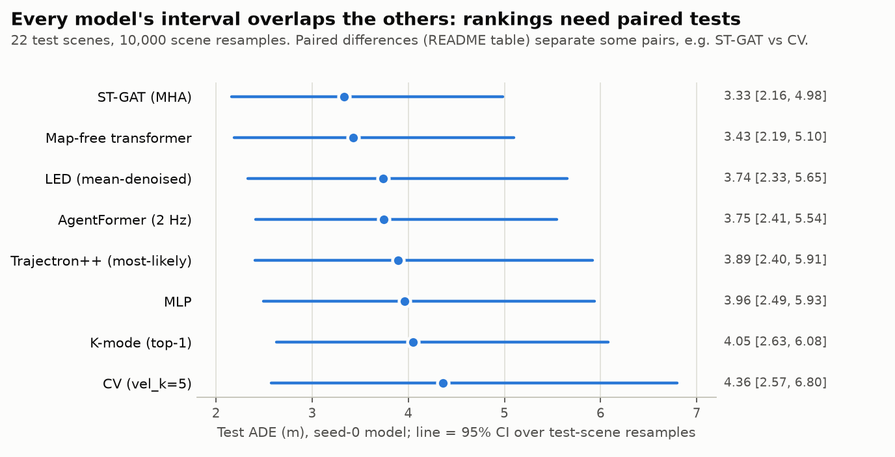
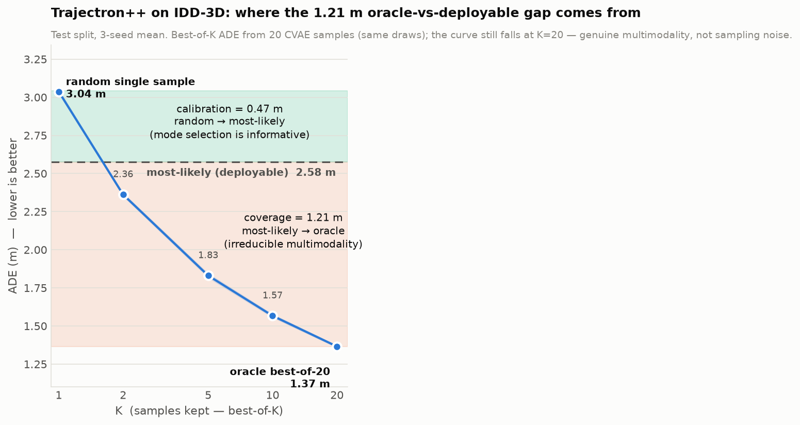
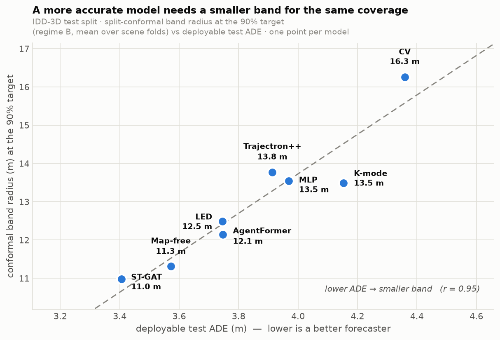
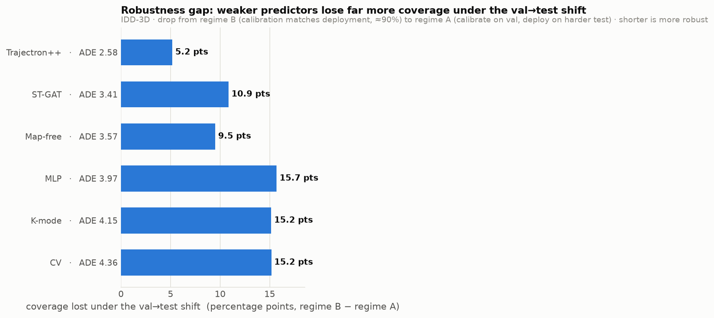
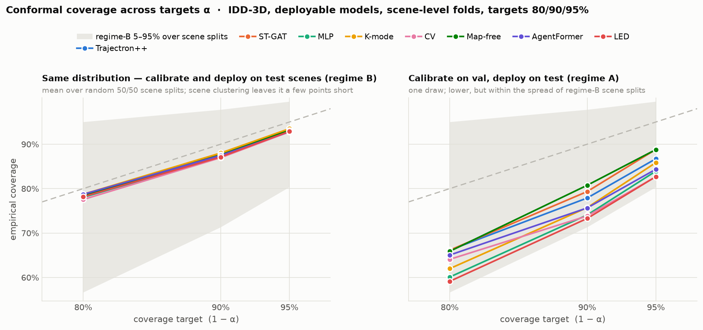
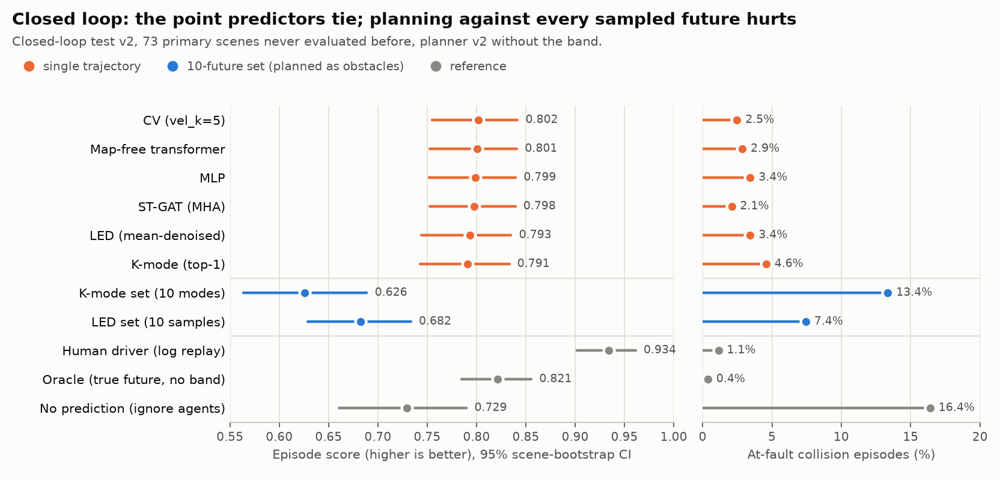
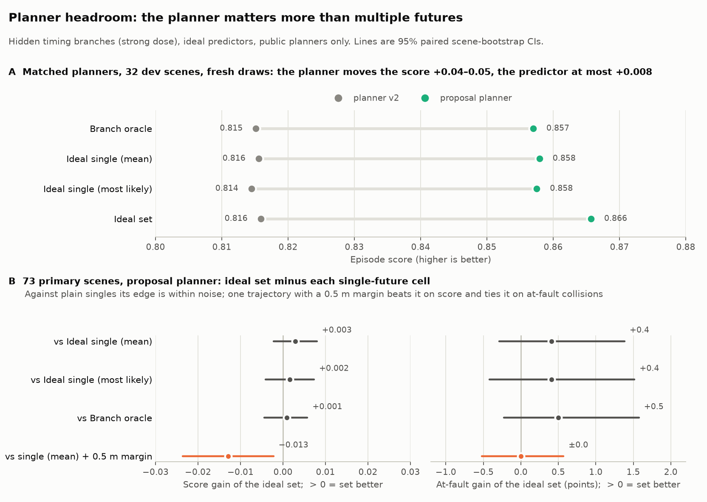

# DreamDrive — Prediction and Planning in Indian Mixed Traffic (IDD-3D)

DreamDrive asks whether trajectory prediction, including multi-future prediction, makes an
automated vehicle measurably safer in unstructured Indian traffic. It benchmarks map-free
forecasters on [IDD-3D](https://idd3d.github.io/) (105 scenes, 10 fps, 22 agent classes),
wraps them in calibrated uncertainty bands, and drives them through pre-registered closed-loop
and planner tests. Observation 2.0 s (20 frames) → prediction 6.0 s (60 frames), `dt = 0.1 s`.
Dataset documentation: [`DATASHEET.md`](DATASHEET.md).

**Capstone project PW26_CGM_04** — Idhant Singh, Rishav Ghosh, Shagal Verma, Shourya Rai (PES University).

---

## Key findings

1. **Forecasting.** On one shared evaluation population and a frozen 22-scene test split, the
   ST-GAT-inspired model (test ADE 3.41 ± 0.07 m) and a map-free transformer (3.57 ± 0.11 m)
   have the lowest errors. They beat the re-run Trajectron++, AgentFormer and LED on every
   seed, but not significantly once both scene and seed variation are counted.
   [→ Benchmark](#results--benchmark-v2)
2. **Uncertainty.** Split-conformal bands land a little under their 90% target on held-out
   scenes, with wide spread across scene splits. Per-class radii fix the under-coverage of cars
   and the over-coverage of pedestrians. Bands that cover a whole 6 s future are about twice as
   wide. [→ Conformal](#calibrated-uncertainty-bands-split-conformal-wrapper)
3. **Open-loop safety.** Every single-trajectory predictor flags near-ego conflicts with AUC
   0.95–0.96. None is separable from constant velocity. [→ Scorecard](#safety-scorecard-pre-registered)
4. **Closed loop.** Prediction itself cuts at-fault collision episodes from 16.4% (ignoring
   other road users) to 2–3%. No learned predictor beats constant velocity, and planning
   against every sampled future of a multi-future model causes *more* collisions.
   [→ Closed loop](#closed-loop-test-v2-cross-validated-pre-registered)
5. **Planner headroom.** With hidden timing intent injected into real scenes, perfect
   knowledge of the future finally beats constant velocity. But the planner moves the score
   far more than the predictor, and one trajectory with a tuned 0.5 m safety margin matches the
   ideal multi-future set. [→ Planner headroom](#planner-headroom-can-knowing-the-future-help)
6. **Lateral intent** built from real IDD-3D tracks rarely changes the ego's immediate
   decision, so that benchmark stopped at its pre-registered validity gate.

In progress: further planner experiments, and a Western → Indian transfer study (Argoverse 2 →
IDD-3D).

## Results integrity

- Every number in a results table is generated from a committed artifact by
  [`scripts/make_tables.py`](scripts/make_tables.py). CI fails if a table is hand-edited
  (`python scripts/make_tables.py --check`). The figures are regenerated from the same artifacts.
- Confirmatory tests are pre-registered: the decision rule is committed before the data it
  decides on is looked at, and each result names that commit.
- Corrections stay visible:
  - **Retractions (July 2026).** Results with no experiment behind them were retracted: a
    claimed degradation of Trajectron++ on collision data, a benchmark table that matched no
    artifact, and a Trajectron++ "correction" that rescaled metrics without re-evaluating. See
    `research/report.txt` §7.2–7.3.
  - **Conformal (October 2026).** The conformal evaluation split test *agents* rather than test
    *scenes*, which overstated coverage. It now splits scenes, and two findings built on it are
    withdrawn (see the conformal section).
  - **Trajectron++ population (October 2026).** Trajectron++ had been scored on its own denser,
    easier population. Re-scored on the shared canonical windows
    ([`scripts/eval_trajectronpp_canonical.py`](scripts/eval_trajectronpp_canonical.py)), its
    deployable test ADE is 3.91 ± 0.08 m, not 2.58 ± 0.04 m. The claims that it was the best
    deployable model, that it was separated from ST-GAT, and that it had the tightest conformal
    band are withdrawn. A test now checks that every ranked row and every conformal input is
    scored on the same population
    ([`tests/test_eval_population_contract.py`](tests/test_eval_population_contract.py)).

## Data

### The ego-motion correction

Raw IDD-3D labels store `psr.position` in the **per-frame ego/LiDAR frame**, so every
trajectory mixed agent motion with ego motion: the median apparent *pedestrian* speed was
**5.05 m/s**. [`scripts/0_compensate_ego_motion.py`](scripts/0_compensate_ego_motion.py)
estimates per-frame SE(2) ego motion from the annotations themselves (RANSAC rigid alignment,
with static objects such as parked vehicles as inliers) and re-expresses all positions in a
per-scene world frame. The median pedestrian speed is then **0.91 m/s**. Diagnostics:
[`outputs/ego_compensation_stats.json`](outputs/ego_compensation_stats.json); regression tests:
[`tests/test_speed_sanity.py`](tests/test_speed_sanity.py). The compensation is an
approximation until official ego poses are available (20.7% of frames fall back to a
constant-velocity ego).

### Pipeline

```
IDD-3D label JSONs (per-frame, ego-relative)
  │ 1_parse_idd3d_positions.py            → outputs/parsed_positions/*.csv          (ego frame)
  │ 0_compensate_ego_motion.py            → outputs/parsed_positions_world/*.csv    (world frame)
  │ 4_export_multiagent_trajpp_format.py  → outputs/multiagent_world_v1/scenes/*.npz (105 scenes)
  │ 5_export_stgat_format.py --presence obs+1fut
  │                                       → outputs/canonical_world_obs20_pred60.npz (718 sequences, 10,576 agents)
  │ 8_make_scene_splits.py                → splits/scene_splits.json                (73 / 10 / 22 scenes)
  │ 9_make_agent_windows_from_canonical.py → per-agent windows for CV and the MLP
  │ 6_export_trajectronpp_world.py        → Trajectron++ export (dt = 0.1 s)
  └ models: model1 CV · model2 MLP · model3 ST-GAT-inspired · model4 K-mode decoder ·
            model5 map-free transformer · model6 AgentFormer · model7 LED ·
            model8 multi-future transformer · model9 AutoBot-Joint · 7_train_eval_trajectronpp.py
```

## Results — Benchmark v2

Protocol:

- **Data:** [`outputs/canonical_world_obs20_pred60.npz`](outputs/canonical_world_obs20_pred60_stats.json),
  world frame, 718 sequences, **10,576 agents**. An agent needs a full 2 s observation and at
  least one future step, with a per-timestep `fut_mask`. Every model is scored on this same
  population.
- **Split:** frozen [`splits/scene_splits.json`](splits/scene_splits.json) (73 / 10 / 22
  scenes, hash-based). Model selection uses val only; **test numbers are final**.
- **Seeds:** {0, 1, 2} affect initialisation and shuffling only, never the split. Cells are
  mean ± std.
- **Metrics:** masked ADE over valid future steps; FDE at each agent's last valid step.
  Oracle rows pick the best mode *after seeing the ground truth*: they are upper bounds, not
  comparable with deployable rows.

<!-- BEGIN AUTOGENERATED: benchmark v2 results (scripts/make_tables.py) -->
| Model | K | Deployable single output? | Test ADE (m) | Test FDE (m) | Val ADE (m) | Seeds |
| --- | --- | --- | --- | --- | --- | --- |
| CV (vel_k=5) | 1 | yes | 4.36 | 9.78 | 2.43 | 0 |
| MLP | 1 | yes | 3.97 ± 0.01 | 8.66 ± 0.05 | 2.31 ± 0.01 | 0,1,2 |
| ST-GAT-inspired (MHA) | 1 | yes | 3.41 ± 0.07 | 7.35 ± 0.16 | 2.38 ± 0.03 | 0,1,2 |
| Map-free transformer | 1 | yes | 3.57 ± 0.11 | 7.85 ± 0.18 | 2.46 ± 0.02 | 0,1,2 |
| K-mode decoder — oracle best-of-10 | 10 | no (oracle) | 1.88 ± 0.05 | 3.18 ± 0.11 | 1.32 ± 0.03 | 0,1,2 |
| K-mode decoder — learned top-1 | 10 | yes | 4.31 ± 0.05 | 9.48 ± 0.24 | 3.38 ± 0.36 | 0,1,2 |
| K-mode decoder (top-1-selected) — oracle best-of-10 | 10 | no (oracle) | 2.01 ± 0.07 | 3.56 ± 0.19 | 1.69 ± 0.09 | 0,1,2 |
| K-mode decoder (top-1-selected) — learned top-1 | 10 | yes | 4.15 ± 0.10 | 9.21 ± 0.26 | 2.61 ± 0.13 | 0,1,2 |
| Trajectron++ — most-likely | 1 | yes | 3.91 ± 0.08 | 8.38 ± 0.24 | 2.73 ± 0.14 | 0,1,2 |
| Trajectron++ — oracle best-of-20 | 20 | no (oracle) | 2.08 ± 0.02 | 3.64 ± 0.04 | 1.35 ± 0.04 | 0,1,2 |
| Trajectron++ hetero (unicycle) — most-likely | 1 | yes | 4.55 ± 0.17 | 10.43 ± 0.54 | 3.13 ± 0.18 | 0,1,2 |
| Trajectron++ hetero (unicycle) — oracle best-of-20 | 20 | no (oracle) | 2.22 ± 0.06 | 4.12 ± 0.06 | 1.39 ± 0.07 | 0,1,2 |
| AgentFormer (upstream, map-free, 2 Hz) — most-likely | 1 | yes | 3.75 ± 0.00 | 8.22 ± 0.27 | 2.44 ± 0.07 | 0,1,2 |
| AgentFormer (upstream, map-free, 2 Hz) — oracle best-of-20 | 20 | no (oracle) | 2.24 ± 0.33 | 4.13 ± 0.74 | 1.25 ± 0.16 | 0,1,2 |
| LED (leapfrog diffusion) — mean-denoised | 1 | yes | 3.75 ± 0.01 | 8.13 ± 0.09 | 2.03 ± 0.02 | 0,1,2 |
| LED (leapfrog diffusion) — oracle best-of-20 | 20 | no (oracle) | 1.98 ± 0.07 | 4.10 ± 0.18 | 1.03 ± 0.04 | 0,1,2 |
| Trajectron++ — most-likely [dense node-timesteps] | 1 | yes | 2.58 ± 0.04 | 5.58 ± 0.07 | 2.14 ± 0.07 | 0,1,2 |
| Trajectron++ — oracle best-of-20 [dense node-timesteps] | 20 | no (oracle) | 1.37 ± 0.01 | 2.39 ± 0.02 | 1.10 ± 0.02 | 0,1,2 |

Every row is scored on the same canonical test windows except those marked *[dense node-timesteps]*: Trajectron++'s own protocol, which predicts at every valid timestep and so includes many late-scene instances with under 2 s of future. Those rows are easier by construction, shown for reference only, and never ranked against the others.

Source artifact: [`outputs/benchmark_v2/summary.json`](outputs/benchmark_v2/summary.json) (aggregated from per-seed metrics JSONs in the same directory).
<!-- END AUTOGENERATED: benchmark v2 results -->

### How certain are these numbers? (scene-level bootstrap)

The ± above is seed-to-seed spread only. The larger uncertainty is *which* 22 scenes landed in
the test split: agents in a scene share an ego drive, a layout and each other's interactions, so
they are not independent. [`scripts/bootstrap_ci.py`](scripts/bootstrap_ci.py) resamples **test
scenes** with replacement and reports per-model CIs and **paired** differences (both models
scored on the same resampled scenes, which removes the shared scene difficulty). For the top
models and LED it also compares 3-seed means, resampling training seeds as well as scenes.



<!-- BEGIN AUTOGENERATED: bootstrap CIs (scripts/make_tables.py) -->
| Model (seed 0) | Test ADE (m) [95% CI] | Test FDE (m) [95% CI] | Test scenes | = seed-0 artifact? |
| --- | --- | --- | --- | --- |
| ST-GAT (MHA) | 3.33 [2.16, 4.98] | 7.16 [4.63, 10.62] | 22 | yes |
| Map-free transformer | 3.43 [2.19, 5.10] | 7.62 [4.86, 11.24] | 22 | yes |
| LED (mean-denoised) | 3.74 [2.33, 5.65] | 8.09 [5.00, 12.26] | 22 | yes |
| AgentFormer (2 Hz, most-likely) | 3.75 [2.41, 5.54] | 8.34 [5.27, 12.41] | 22 | yes |
| Trajectron++ (most-likely) | 3.89 [2.40, 5.91] | 8.41 [5.32, 12.62] | 22 | yes |
| MLP | 3.96 [2.49, 5.93] | 8.62 [5.50, 12.83] | 22 | yes |
| K-mode (top-1) | 4.05 [2.63, 6.08] | 9.05 [5.80, 13.35] | 22 | yes |
| CV (vel_k=5) | 4.36 [2.57, 6.80] | 9.78 [5.92, 14.99] | 22 | yes |

Paired comparisons of the seed-0 models adjacent in the ranking (same scene resample for both; negative = the first model is better):

| Comparison | ΔADE (m) | 95% CI | Separated at 95%? |
| --- | --- | --- | --- |
| ST-GAT (MHA) vs Map-free transformer | -0.10 | [-0.36, 0.13] | no |
| Map-free transformer vs LED (mean-denoised) | -0.31 | [-0.66, -0.08] | yes |
| LED (mean-denoised) vs AgentFormer (2 Hz, most-likely) | -0.01 | [-0.31, 0.30] | no |
| AgentFormer (2 Hz, most-likely) vs Trajectron++ (most-likely) | -0.15 | [-0.63, 0.23] | no |
| Trajectron++ (most-likely) vs MLP | -0.07 | [-0.36, 0.24] | no |
| MLP vs K-mode (top-1) | -0.08 | [-0.64, 0.49] | no |
| K-mode (top-1) vs CV (vel_k=5) | -0.31 | [-0.99, 0.21] | no |

Seed-pooled paired comparisons for the models with a dump per seed (3-seed means, seeds 0, 1, 2). Each replicate resamples the test scenes for both models and each model's seeds with replacement, so the CI covers training-seed variation as well:

| Comparison | ΔADE (m), 3-seed means | 95% CI | Separated at 95%? | Seed pairings where the first is better |
| --- | --- | --- | --- | --- |
| ST-GAT (MHA) vs Map-free transformer | -0.17 | [-0.48, 0.13] | no | 8 of 9 |
| ST-GAT (MHA) vs LED (mean-denoised) | -0.34 | [-0.76, 0.01] | no | 9 of 9 |
| Map-free transformer vs LED (mean-denoised) | -0.17 | [-0.55, 0.11] | no | 9 of 9 |

Where the two tables disagree, cite the seed-pooled row: a single seed can be a model's luckiest or unluckiest run.

Per-class ADE disparity for ST-GAT (MHA) (classes with n ≥ 50): **12.5×**, 95% CI 6.7–24.0× (worst Car, 20 test scenes; best Scooter, 6 test scenes).

Source artifact: [`outputs/benchmark_v2/bootstrap_ci.json`](outputs/benchmark_v2/bootstrap_ci.json) (10,000 scene resamples of the 22 test scenes).
<!-- END AUTOGENERATED: bootstrap CIs -->

Rankings are claimed only where the paired CI excludes zero (the "Separated" column); pairs
that are not separated are ties on this test set. An absolute ADE from this benchmark should not
be compared with one measured on a different split.

### Per-class fairness audit (test split)

Per-class error for the deployable model with the lowest mean test ADE. `ADE per path-meter`
normalises by how far the agent actually travels, so fast classes are not trivially "worse".

<!-- BEGIN AUTOGENERATED: per-class audit (scripts/make_tables.py) -->
Lowest mean test ADE among deployable models: **ST-GAT-inspired (MHA)** (per-class stats from one representative seed; see the bootstrap section for whether it is separated from the runner-up).

| Class | n | ADE (m) | FDE (m) | Mean GT path (m) | ADE per path-meter |
| --- | --- | --- | --- | --- | --- |
| MotorcyleRider | 396 | 4.12 | 9.12 | 25.6 | 0.161 |
| Pedestrian | 372 | 1.10 | 2.17 | 4.2 | 0.263 |
| Car | 336 | 5.25 | 11.31 | 25.1 | 0.209 |
| ScooterRider | 328 | 5.38 | 12.00 | 28.8 | 0.187 |
| Truck | 278 | 2.56 | 5.55 | 11.8 | 0.217 |
| TourCar | 247 | 4.62 | 9.42 | 22.8 | 0.203 |
| Scooter | 50 | 0.53 | 1.19 | 1.6 | 0.328 |

ADE disparity (worst/best class, n ≥ 50): **10.25×**
<!-- END AUTOGENERATED: per-class audit -->

### Where the oracle-vs-deployable gap comes from (Trajectron++)

Trajectron++'s most-likely output (3.91 m) is 1.83 m behind its oracle best-of-20 (2.08 m). A
best-of-K sweep plus a random-sample readout from the same 20 draws
([`scripts/eval_trajectronpp_canonical.py`](scripts/eval_trajectronpp_canonical.py)) splits the
gap into a calibration slice and a coverage slice:



<!-- BEGIN AUTOGENERATED: trajectronpp gap decomposition (scripts/make_tables.py) -->
| Readout | Test ADE (m) | Meaning |
| --- | --- | --- |
| Random single sample (best-of-1 ≈ mean-sample) | 4.55 | one draw, blind |
| **Most-likely (deployable)** | **3.91** | argmax latent + GMM mode |
| Oracle best-of-20 | 2.08 | min over samples, picked in hindsight |

Best-of-K curve (K = 1, 2, 5, 10, 20): **4.51 → 3.54 → 2.79 → 2.38 → 2.08**.

- **Calibration value = 0.64 m** (random draw → most-likely): the deployable mode beats a random sample — the mode selection is genuinely informative.
- **Coverage value = 1.83 m** (most-likely → oracle): the irreducible cost of committing to one future. The curve is still falling at the largest K, the signature of genuine multimodality rather than sampling noise — only multiple deployed modes can close it.

Source artifact: [`outputs/benchmark_v2/summary.json`](outputs/benchmark_v2/summary.json) (`trajectronpp_gap_decomposition`, 3-seed test mean on the canonical windows).
<!-- END AUTOGENERATED: trajectronpp gap decomposition -->

### Calibrated uncertainty bands (split-conformal wrapper)

A post-hoc wrapper ([`scripts/conformal_wrapper.py`](scripts/conformal_wrapper.py)) turns each
deployable point predictor into an uncertainty band around its forecast, with no retraining.
The nonconformity score is the per-step position error; the inputs are each seed-0 model's
predictions on the canonical windows. Two kinds of band:

- **per-step:** a radius r_t per future step. Each *step* is covered with probability ≥ 1 − α,
  but not the whole future.
- **simultaneous:** r_t = q · σ_t, with a per-step scale σ_t fitted on half of the calibration
  scenes and q the conformal quantile of each agent's max_t error_t / σ_t on the other half. It
  covers the agent's **whole valid future**, which is what a planner needs.

Each comes with one global radius or with per-class radii (Mondrian conformal prediction), in
two regimes: **B** (same distribution: calibrate on half of the test scenes, evaluate on the
other half, over 100 random scene splits) and **A** (deployment: calibrate on val, evaluate on
test, with a scene-bootstrap CI).

<!-- BEGIN AUTOGENERATED: conformal coverage (scripts/make_tables.py) -->
| Predictor | B: step coverage, mean (5–95%) over 100 scene folds | A: val→test step coverage [95% CI] | B folds at or below A | Trajectory coverage: per-step band | Trajectory coverage: simultaneous band | Mean radius (m): per-step / simultaneous |
| --- | --- | --- | --- | --- | --- | --- |
| Trajectron++ (most-likely) | 87.2% (70.0%–97.8%) | 77.9% [64.2%, 89.1%] | 17% | 74.6% | 86.4% | 13.8 / 27.8 |
| LED (mean-denoised) | 87.1% (71.2%–97.7%) | 73.3% [57.8%, 86.2%] | 9% | 73.5% | 86.6% | 12.5 / 26.4 |
| AgentFormer (2 Hz, most-likely) | 87.5% (69.1%–97.6%) | 75.7% [61.6%, 87.3%] | 12% | 73.4% | 87.0% | 12.1 / 23.7 |
| ST-GAT (MHA) | 87.7% (73.2%–98.0%) | 79.3% [66.8%, 89.1%] | 18% | 73.3% | 86.5% | 11.0 / 21.9 |
| Map-free transformer | 87.6% (71.4%–97.6%) | 80.8% [67.8%, 91.2%] | 22% | 73.6% | 86.7% | 11.3 / 22.0 |
| MLP | 87.1% (71.3%–97.5%) | 74.1% [59.3%, 86.5%] | 8% | 72.1% | 86.2% | 13.5 / 28.9 |
| K-mode (top-1) | 88.0% (74.0%–97.8%) | 75.7% [63.3%, 85.3%] | 10% | 74.0% | 86.7% | 13.5 / 26.6 |
| CV (vel_k=5) | 87.0% (70.5%–98.3%) | 73.8% [57.7%, 87.1%] | 11% | 74.0% | 86.1% | 16.3 / 32.3 |

Per-class step coverage (regime B, mean over scene folds; target 90%): one global radius vs per-class (Mondrian) radii:

| Predictor | Car: global → per-class | Pedestrian: global → per-class | MotorcyleRider: global → per-class |
| --- | --- | --- | --- |
| Trajectron++ (most-likely) | 80.2% → 87.3% | 95.9% → 88.6% | 87.3% → 88.2% |
| LED (mean-denoised) | 79.6% → 88.3% | 94.2% → 87.7% | 88.3% → 88.6% |
| AgentFormer (2 Hz, most-likely) | 80.3% → 88.1% | 95.6% → 87.1% | 88.5% → 89.1% |
| ST-GAT (MHA) | 79.1% → 87.9% | 95.2% → 88.0% | 88.2% → 89.3% |
| Map-free transformer | 80.3% → 88.3% | 96.3% → 88.1% | 87.3% → 89.0% |
| MLP | 79.5% → 87.8% | 94.5% → 88.3% | 87.5% → 88.3% |
| K-mode (top-1) | 80.9% → 87.8% | 96.3% → 88.3% | 85.5% → 89.1% |
| CV (vel_k=5) | 78.4% → 86.9% | 95.0% → 88.0% | 87.8% → 88.5% |

Source artifact: [`outputs/benchmark_v2/conformal_metrics.json`](outputs/benchmark_v2/conformal_metrics.json) (α = 0.1, 2,000 scene resamples for the regime-A CIs).
<!-- END AUTOGENERATED: conformal coverage -->

What this shows (α = 0.1):

1. **Scene clustering limits coverage on 22 test scenes.** Regime B lands a little under
   target on average and varies widely between scene splits. The guarantee is exact for
   exchangeable units, but agents within a scene are correlated.
2. **The val→test drop is not distinguishable from scene sampling.** Regime A sits inside the
   spread that random no-shift scene splits produce (column 4). *Withdrawn (October 2026):* the
   claims that naive conformal "fails under the val→test shift" and that "stronger predictors
   survive the shift better".
3. **Per-step bands do not cover whole futures; simultaneous bands do, at about twice the
   radius.** That width is the main obstacle to using these bands for planning.
4. **Per-class radii fix per-class unfairness** robustly across scene splits: one global radius
   under-covers cars and over-covers pedestrians.
5. **A more accurate forecaster buys a tighter band** at a fixed coverage target:





**Robustness to the coverage target.** α = 0.1 is a reporting convention, not a safety
specification. [`scripts/conformal_alpha_sensitivity.py`](scripts/conformal_alpha_sensitivity.py)
repeats the evaluation at 80% / 90% / 95%; the picture is the same at every target.



<!-- BEGIN AUTOGENERATED: conformal alpha sensitivity (scripts/make_tables.py) -->
| Model | B @ 80% | A @ 80% | B @ 90% | A @ 90% | B @ 95% | A @ 95% |
| --- | --- | --- | --- | --- | --- | --- |
| Trajectron++ (most-likely) | 78.2% | 66.2% | 87.2% | 77.9% | 92.8% | 86.7% |
| LED (mean-denoised) | 78.2% | 59.1% | 87.1% | 73.3% | 92.9% | 82.7% |
| AgentFormer (2 Hz, most-likely) | 78.7% | 65.0% | 87.5% | 75.7% | 92.8% | 84.4% |
| ST-GAT (MHA) | 78.7% | 66.1% | 87.7% | 79.3% | 93.1% | 88.8% |
| Map-free transformer | 78.5% | 65.9% | 87.6% | 80.8% | 93.1% | 88.8% |
| MLP | 78.0% | 60.1% | 87.1% | 74.1% | 92.9% | 83.9% |
| K-mode (top-1) | 78.7% | 62.0% | 88.0% | 75.7% | 93.5% | 85.9% |
| CV (vel_k=5) | 77.6% | 64.1% | 87.0% | 73.8% | 92.8% | 82.7% |

Mean per-step band radius (regime B, scene-fold mean) at each target:

| Model | 80% | 90% | 95% |
| --- | --- | --- | --- |
| Trajectron++ (most-likely) | 8.2 m | 13.8 m | 20.0 m |
| LED (mean-denoised) | 8.0 m | 12.5 m | 18.1 m |
| AgentFormer (2 Hz, most-likely) | 7.8 m | 12.1 m | 17.2 m |
| ST-GAT (MHA) | 6.8 m | 11.0 m | 16.8 m |
| Map-free transformer | 7.0 m | 11.3 m | 16.2 m |
| MLP | 8.5 m | 13.5 m | 19.2 m |
| K-mode (top-1) | 8.2 m | 13.5 m | 21.7 m |
| CV (vel_k=5) | 9.9 m | 16.3 m | 23.9 m |

Source artifact: [`outputs/benchmark_v2/conformal_sensitivity.json`](outputs/benchmark_v2/conformal_sensitivity.json) (100 scene folds per target).
<!-- END AUTOGENERATED: conformal alpha sensitivity -->

## Safety and closed-loop driving

### Safety scorecard (pre-registered)

Mean ADE ranks forecasters, not safety. The scorecard asks which predictor best foresees the
agents that actually come close to the ego vehicle, without flagging everyone. The rule was
committed **before** any scorecard number was computed
([`docs/wiki/safety-scorecard.md`](docs/wiki/safety-scorecard.md)):

- **Candidates:** 8 single-trajectory predictors and 4 multi-future sets (10 futures each),
  seeds 0–2, each with a per-step, per-class 90% conformal band calibrated on val.
- **Conflict:** the agent's true position comes within 5 m of the ego's actual position at the
  same future step.
- **Pick:** the highest test conflict AUC; ties (paired 95% CI includes 0) go to the AUC on
  pedestrians and two-wheeler riders, then to latency.

<!-- BEGIN AUTOGENERATED: safety scorecard (scripts/make_tables.py) -->
Rule committed in `a33f7f0` before any of these numbers existed. Test split: 2,177 agents, 276 conflicts (195 of them pedestrians or two-wheeler riders).

| Package | Output | Conflict AUC [95% CI] | Pedestrians & two-wheelers AUC | Recall / false alarms at the 90% band | Latency (ms, median) |
| --- | --- | --- | --- | --- | --- |
| ST-GAT (MHA) | 1 trajectory + band | 0.961 [0.932, 0.981] | 0.965 [0.937, 0.983] | 96% / 22% | 8.0 |
| Map-free transformer | 1 trajectory + band | 0.960 [0.928, 0.981] | 0.959 [0.920, 0.982] | 97% / 22% | 3.2 |
| K-mode (top-1) | 1 trajectory + band | 0.958 [0.927, 0.981] | 0.961 [0.927, 0.984] | 97% / 23% | 19.4 |
| LED (mean-denoised) | 1 trajectory + band | 0.958 [0.925, 0.981] | 0.958 [0.919, 0.981] | 96% / 20% | 27.4 |
| MLP | 1 trajectory + band | 0.957 [0.923, 0.982] | 0.959 [0.918, 0.983] | 96% / 24% | 0.6 |
| AgentFormer (most-likely) | 1 trajectory + band | 0.957 [0.924, 0.981] | 0.956 [0.917, 0.981] | 96% / 21% | 58.4 |
| Trajectron++ (most-likely) | 1 trajectory + band | 0.952 [0.918, 0.977] | 0.949 [0.906, 0.976] | 97% / 27% | 195.2 |
| CV (vel_k=5) | 1 trajectory + band | 0.951 [0.914, 0.979] | 0.954 [0.912, 0.980] | 95% / 22% | 0.0 |
| Trajectron++ set (10 samples) | 10 futures + band | 0.942 [0.907, 0.969] | 0.934 [0.887, 0.968] | 98% / 28% | 212.8 |
| AgentFormer set (10 samples) | 10 futures + band | 0.940 [0.907, 0.966] | 0.937 [0.890, 0.969] | 97% / 24% | 102.3 |
| LED set (10 samples) | 10 futures + band | 0.935 [0.893, 0.965] | 0.934 [0.881, 0.969] | 97% / 32% | 42.6 |
| K-mode set (10 modes) | 10 futures + band | 0.898 [0.850, 0.934] | 0.875 [0.808, 0.926] | 100% / 53% | 18.7 |

How the pre-registered rule decided:

1. Leader on P (conflict AUC): ST-GAT (MHA) (0.961).
2. Tied with the leader on P (paired 95% CI includes 0): CV (vel_k=5), MLP, Map-free transformer, K-mode (top-1), AgentFormer (most-likely), LED (mean-denoised), Trajectron++ (most-likely).
3. Tie-break 1 (vulnerable road users): best ST-GAT (MHA) (0.965); still tied: CV (vel_k=5), MLP, Map-free transformer, K-mode (top-1), AgentFormer (most-likely), LED (mean-denoised), Trajectron++ (most-likely).
4. Tie-break 2 (latency): CV (vel_k=5) at 0.0 ms.

**Rule outcome: CV (vel_k=5).**

Exploratory (added after the result, not used for the pick): current distance alone flags conflicts with AUC 0.754, and 58% of conflict agents are already within 10 m when the prediction is made. On the 116 emerging conflicts (more than 10 m away at prediction time), the best package is Map-free transformer at 0.956, against 0.937 for constant velocity.

Source artifacts: [`outputs/benchmark_v2/safety_scorecard.json`](outputs/benchmark_v2/safety_scorecard.json), [`outputs/benchmark_v2/safety_latency.json`](outputs/benchmark_v2/safety_latency.json) (2,000 seed-pooled scene resamples; latency on NVIDIA RTX 4500 Ada Generation).
<!-- END AUTOGENERATED: safety scorecard -->

**What it means.** The rule picks constant velocity because the test cannot separate the
predictors, not because CV is safest: the rule falls through to latency. Current distance alone
reaches AUC 0.75, and any predictor lifts it to about 0.95, so motion extrapolation provides
almost all of the benefit. Multi-future sets raise more false alarms at the same coverage. This
is an open-loop proxy (the ego path is what the human drove), which is why the closed-loop
tests follow.

### Closed-loop test v2: cross-validated (pre-registered)

The first pre-registered closed-loop test
([`docs/wiki/closed-loop-test.md`](docs/wiki/closed-loop-test.md),
[`closed_loop.json`](outputs/benchmark_v2/closed_loop.json)) also found no predictor
demonstrably safest, and exposed three problems: a ~6% false-collision floor in the measurement,
90% bands that paralysed the planner, and too few test scenes. The second test fixes all three
([`docs/wiki/closed-loop-cv.md`](docs/wiki/closed-loop-cv.md), committed before any fold model
drove a primary scene):

- **Measurement:** ego-pose glitches are excluded, the ego is oriented by its logged yaw, and
  collisions use exact rectangles with a footprint measured from the data. The human replay's
  false at-fault rate falls to 0–1.1%.
- **Planner:** each predictor drives a sampling planner that replans every 0.2 s. A grid on the
  32 development scenes chose a 1 s hard safety horizon, a soft penalty beyond it and **no
  conformal band**.
- **Scenes:** 5-fold scene cross-validation retrains CV, MLP, ST-GAT, the transformer and LED,
  so every scene is driven by models that never saw it. The **primary** analysis uses the 73
  scenes never evaluated before. Episodes score 0 after an at-fault collision; otherwise they
  combine progress, the absence of harsh braking and the absence of near misses (nuPlan style).



<!-- BEGIN AUTOGENERATED: closed-loop cv (scripts/make_tables.py) -->
Rule committed in `24684e2` before any fold model drove a primary scene. Primary set: 73 scenes never evaluated before, 524 episodes per package; one model per fold (seed 0); planner v2 without the band.

| Package | Episode score [95% CI] | At-fault collision episodes | …with pedestrians / two-wheelers | Harsh braking | Score with the full 90% band |
| --- | --- | --- | --- | --- | --- |
| CV (vel_k=5) | 0.802 [0.755, 0.842] | 2.5% | 2.3% | 18% | 0.657 |
| Map-free transformer | 0.801 [0.753, 0.841] | 2.9% | 2.1% | 19% | 0.668 |
| MLP | 0.799 [0.752, 0.840] | 3.4% | 2.5% | 22% | 0.666 |
| ST-GAT (MHA) | 0.798 [0.753, 0.839] | 2.1% | 1.3% | 21% | 0.653 |
| LED (mean-denoised) | 0.793 [0.744, 0.835] | 3.4% | 2.9% | 22% | 0.672 |
| K-mode (top-1) (secondary) | 0.791 [0.743, 0.833] | 4.6% | 3.8% | 20% | 0.664 |
| K-mode set (10 modes) (secondary) | 0.626 [0.564, 0.689] | 13.4% | 9.4% | 63% | 0.537 |
| LED set (10 samples) (secondary) | 0.682 [0.629, 0.733] | 7.4% | 4.8% | 56% | 0.621 |
| *Human driver (log replay)* (reference) | 0.934 [0.902, 0.961] | 1.1% | 0.0% | 0% | — |
| *Oracle (true future, no band)* (reference) | 0.821 [0.785, 0.856] | 0.4% | 0.0% | 13% | — |
| *No prediction (ignore agents)* (reference) | 0.729 [0.661, 0.790] | 16.4% | 9.7% | 2% | — |

How the pre-registered rule decided:

1. Leader on the episode score: CV (vel_k=5) (0.802).
2. Tied with the leader (paired 95% CI includes 0): MLP, ST-GAT (MHA), Map-free transformer, LED (mean-denoised).
3. Tie-break 1 (at-fault collisions with pedestrians / two-wheelers, lower is better): best ST-GAT (MHA) (0.013); still tied: CV (vel_k=5), MLP, Map-free transformer, LED (mean-denoised).
4. Tie-break 2 (latency): CV (vel_k=5).

**Rule outcome: CV (vel_k=5).**

Differences are signed so that positive values favour the hypothesis.

| Hypothesis (one-sided, Holm) | Difference, 95% CI | p (Holm) | Supported | Supported in the 7 instrument variants |
| --- | --- | --- | --- | --- |
| H1 ST-GAT (MHA) higher score than CV | [-0.019, 0.011] | 1.000 | no | 0/7 |
| H1b ST-GAT (MHA) fewer at-fault collisions than CV | [-0.014, 0.025] | 1.000 | no | 0/7 |
| H1 Map-free transformer higher score than CV | [-0.016, 0.014] | 1.000 | no | 0/7 |
| H1b Map-free transformer fewer at-fault collisions than CV | [-0.017, 0.009] | 1.000 | no | 0/7 |
| H1 LED (mean-denoised) higher score than CV | [-0.021, 0.004] | 1.000 | no | 0/7 |
| H1b LED (mean-denoised) fewer at-fault collisions than CV | [-0.024, 0.004] | 1.000 | no | 0/7 |
| H2 CV (vel_k=5) fewer at-fault collisions than ignoring agents | [0.084, 0.199] | 0.000 | yes | 7/7 |
| H2 MLP fewer at-fault collisions than ignoring agents | [0.076, 0.191] | 0.000 | yes | 7/7 |
| H2 ST-GAT (MHA) fewer at-fault collisions than ignoring agents | [0.087, 0.205] | 0.000 | yes | 7/7 |
| H2 Map-free transformer fewer at-fault collisions than ignoring agents | [0.081, 0.197] | 0.000 | yes | 7/7 |
| H2 LED (mean-denoised) fewer at-fault collisions than ignoring agents | [0.075, 0.191] | 0.000 | yes | 7/7 |
| H3 CV (vel_k=5) chosen band setting (x0) scores higher than x1 | [0.111, 0.180] | 0.000 | yes | 7/7 |
| H3 MLP chosen band setting (x0) scores higher than x1 | [0.096, 0.167] | 0.000 | yes | 7/7 |
| H3 ST-GAT (MHA) chosen band setting (x0) scores higher than x1 | [0.109, 0.181] | 0.000 | yes | 7/7 |
| H3 Map-free transformer chosen band setting (x0) scores higher than x1 | [0.096, 0.170] | 0.000 | yes | 7/7 |
| H3 LED (mean-denoised) chosen band setting (x0) scores higher than x1 | [0.086, 0.158] | 0.000 | yes | 7/7 |
| S1 K-mode set (10 modes) higher score than K-mode (top-1) | [-0.217, -0.111] | 1.000 | no | — |
| S2 K-mode set (10 modes) fewer at-fault collisions than K-mode (top-1) | [-0.138, -0.044] | 1.000 | no | — |
| S1 LED set (10 samples) higher score than LED (mean-denoised) | [-0.149, -0.075] | 1.000 | no | — |
| S2 LED set (10 samples) fewer at-fault collisions than LED (mean-denoised) | [-0.069, -0.013] | 1.000 | no | — |

Instrument sensitivity: the rule picks CV (vel_k=5) in every one of the 7 variants.

Other scene sets (reported, not used for the decision): development (32 frozen val + test scenes): pick CV (vel_k=5); all 105 scenes: pick CV (vel_k=5).

Amendment 3 (secondary, same primary scenes and planner): three more multi-future models, each as its single trajectory and its 10-future set.

| Package | Episode score [95% CI] | At-fault collision episodes | …with pedestrians / two-wheelers | Harsh braking | Score with the full 90% band |
| --- | --- | --- | --- | --- | --- |
| MF transformer (top-1) | 0.790 [0.742, 0.833] | 3.6% | 2.5% | 22% | 0.650 |
| MF transformer set (10 modes) | 0.438 [0.379, 0.494] | 19.3% | 12.0% | 93% | 0.425 |
| AgentFormer (most-likely) | 0.800 [0.755, 0.840] | 2.9% | 2.5% | 19% | 0.664 |
| AgentFormer set (10 samples) | 0.793 [0.743, 0.838] | 3.4% | 2.9% | 25% | 0.673 |
| Trajectron++ (most-likely) | 0.799 [0.751, 0.841] | 3.4% | 3.1% | 20% | 0.650 |
| Trajectron++ set (10 samples) | 0.752 [0.697, 0.798] | 4.4% | 3.4% | 44% | 0.617 |

| Hypothesis (one-sided, Holm within amendment 3) | Difference, 95% CI | p (Holm) | Supported |
| --- | --- | --- | --- |
| S1 MF transformer set (10 modes) higher score than MF transformer (top-1) | [-0.415, -0.291] | 1.000 | no |
| S2 MF transformer set (10 modes) fewer at-fault collisions than MF transformer (top-1) | [-0.228, -0.084] | 1.000 | no |
| S1 AgentFormer set (10 samples) higher score than AgentFormer (most-likely) | [-0.023, 0.008] | 1.000 | no |
| S2 AgentFormer set (10 samples) fewer at-fault collisions than AgentFormer (most-likely) | [-0.017, 0.002] | 1.000 | no |
| S1 Trajectron++ set (10 samples) higher score than Trajectron++ (most-likely) | [-0.072, -0.022] | 1.000 | no |
| S2 Trajectron++ set (10 samples) fewer at-fault collisions than Trajectron++ (most-likely) | [-0.029, 0.010] | 1.000 | no |
| T1 MF transformer (top-1) higher score than Map-free transformer | [-0.026, 0.005] | 1.000 | no |
| T2 MF transformer (top-1) fewer at-fault collisions than Map-free transformer | [-0.021, 0.002] | 1.000 | no |

Source artifacts: [`outputs/benchmark_v2/closed_loop_cv.json`](outputs/benchmark_v2/closed_loop_cv.json), [`outputs/benchmark_v2/closed_loop_cv_sensitivity.json`](outputs/benchmark_v2/closed_loop_cv_sensitivity.json), [`outputs/benchmark_v2/closed_loop_cv_extra.json`](outputs/benchmark_v2/closed_loop_cv_extra.json).
<!-- END AUTOGENERATED: closed-loop cv -->

**What the confirmatory test shows:**

1. **No predictor is demonstrably safest in closed loop.** The five single-trajectory packages
   are within 0.01 of each other (0.793–0.802), and learned models do not beat constant
   velocity on score or collisions in any of the 7 instrument variants.
2. **Prediction itself matters.** Every predictor cuts at-fault collision episodes from 16.4%
   (ignoring agents) to 2–3%, in all 7 variants.
3. **The conformal band hurts this planner** (≈ 0.66 with the full band vs ≈ 0.80 without).
4. **Planning against every future of a multi-future set is unsafe.** All five multi-future
   models score below their own single trajectory or level with it, never above, and the K-mode
   and LED sets cause *more* at-fault collisions (13.4% vs 4.6%, 7.4% vs 3.4%). When ten futures
   block the road, the planner's fallback manoeuvres cause the collisions. Whether multi-future
   prediction pays off depends on how the planner uses it: the next section.
5. **The planner, not prediction accuracy, is the limit.** The oracle, which drives against the
   true future, scores only 0.821; the recorded human scores 0.934.

Caveats: the agents don't react; footprints are nominal; one seed per fold; the planner was
tuned on the development scenes, which are excluded from the primary set.

## Planner headroom: can knowing the future help?

In replayed scenes a perfect predictor scores no better than constant velocity, so no predictor,
single or multi-future, can show a benefit there. The headroom test
([`docs/wiki/headroom-test.md`](docs/wiki/headroom-test.md), simulator
[`scripts/counterfactual_sim.py`](scripts/counterfactual_sim.py)) first creates room for
prediction to matter, using ideal predictors only:

- **Hidden intent.** Up to three road users per episode that enter the ego's path keep their
  logged path but follow one of three hidden timing branches: as logged (prior 0.5), hesitate,
  or go first (0.25 each). Branches are drawn identically for every package and don't react to
  the ego.
- **Ideal predictors.** The *branch oracle* knows the realised branch. The *ideal singles*
  commit to the most likely or the posterior-mean branch. The *ideal set* carries every branch
  still consistent with the observed past, with its posterior weight: the ideal multi-future
  predictor. A branch is ruled out once it is 0.3 m from the observed past, the scale of the
  annotation jitter.
- **Stage 1 (gate G1): does perfect information beat constant velocity by a margin fixed in
  advance?** At the strong dose (32 development scenes, 880 episodes per package), yes. The
  ideal singles already capture the oracle's whole gain
  ([`headroom_stage1.json`](outputs/benchmark_v2/headroom_stage1.json)):

  | Package (strong dose, planner v2) | Score | At-fault | Pedestrian / two-wheeler at-fault |
  |---|---|---|---|
  | No prediction | 0.727 | 18.8% | 10.2% |
  | CV | 0.795 | 5.1% | 3.6% |
  | Branch oracle | 0.820 | 1.9% | 0.9% |
  | Ideal single (mean) | 0.823 | 2.0% | 0.7% |
  | Ideal set | 0.823 | 1.6% | 0.9% |

  Branch oracle − CV: +0.025 score, −3.2 points at-fault. At the primary dose (+0.013, −1.0
  point) the gate was missed, so every later stage uses the strong dose.



- **Matched planners (panel A).** Every ideal predictor drove under planner v2 and under a
  proposal planner ([`scripts/proposal_planner.py`](scripts/proposal_planner.py)) tuned on
  separate draws, on fresh draws of the 32 development scenes. Changing the planner gains +0.04
  to +0.05 score (near misses fall from 45% to 32%). Changing the predictor gains at most +0.008
  (ideal set vs the best ideal single under the proposal planner, 95% CI [−0.001, +0.018]),
  below the pre-registered threshold
  ([`headroom_matched.json`](outputs/benchmark_v2/headroom_matched.json)).
- **Confirmation on the 73 primary scenes (panel B).** The set's edge over the plain singles
  shrinks to +0.002–0.003 score, and no interval excludes zero. A single trajectory with a
  0.5 m safety margin (the margin tuned on development draws) matches the set on at-fault
  collisions (0.97% each) and beats it on score by 0.013 (95% CI [0.002, 0.024]), at the price
  of more harsh braking (18% vs 11%)
  ([`headroom_confirm.json`](outputs/benchmark_v2/headroom_confirm.json)).
- **Lateral intent** (cut in or cross instead of timing): built from real IDD-3D tracks, it
  failed its pre-registered validity gate on the development scenes. Only 16–18% of episodes
  needed a different first second of driving (gate 20%), and alternative futures were 1.2–1.3 m
  apart at 4 s (gate 1.5 m), so its confirmation was not run
  ([`lateral_validity.json`](outputs/benchmark_v2/lateral_validity.json)).

**Reading.** Under timing uncertainty, what the ideal multi-future set adds over one trajectory
is explained by caution: a single trajectory with a well-chosen buffer reproduces it, more
cheaply. The planner is the larger lever. Caveats: branches don't react to the ego, and the 73
primary scenes had been used in earlier tests (fresh draws are new realisations, not new scenes).

## Honest takeaways

1. **Two models share the top: ST-GAT-inspired and the map-free transformer.** They are tied
   with each other (seed-pooled ΔADE −0.17 m, 95% CI [−0.48, 0.13]). Both have lower test ADE
   than LED, AgentFormer and Trajectron++ on every seed, but the seed-pooled CIs against LED do
   not exclude zero, so "consistently lower ADE" is the defensible claim, not "significantly
   better". The published models also run under this benchmark's constraints: no map, no yaw,
   AgentFormer at 2 Hz.
2. **Validation and test disagree on the order.** LED has the best val ADE on every seed, so
   selecting on 10 val scenes would have picked it. Rankings are claimed only where the paired
   test-scene CI excludes zero.
3. **Interaction modelling earns its keep on the full population.** On the canonical dataset
   ST-GAT beats MLP (ΔADE −0.63 m, CI [−1.07, −0.28]) and CV (−1.03 m, CI [−1.96, −0.32]).
4. **No multimodal model turns its samples into a better single forecast.** Every multimodal
   model loses 1.5–2.4 m when it commits to one output, and none of those single outputs beats
   the two single-output leaders. Mode selection, not mode diversity, is the bottleneck. For
   the K-mode decoder, selecting checkpoints on val top-1 ADE helped (test 4.31 → 4.15 m);
   evolving winner-takes-all and a trajectory-aware mode scorer did not
   ([`mfp_ewta_grid/`](outputs/benchmark_v2/mfp_ewta_grid/),
   [`mfp_content_grid/`](outputs/benchmark_v2/mfp_content_grid/)).
5. **Unicycle dynamics with approximate heading do not pay off.** Modelling wheeled classes
   with unicycle dynamics in Trajectron++ worsens most-likely test ADE (4.55 vs 3.91 m), mostly
   for moving vehicles; true yaw is the prerequisite
   ([`tpp_hetero_grid/`](outputs/benchmark_v2/tpp_hetero_grid/)).
6. **The frozen test split is genuinely harder than val** (test ADE 1.3–1.9× val ADE for every
   deployable model).
7. **Raw errors concentrate on fast riders and cars, but per metre travelled pedestrians err
   most** (0.263 ADE per path-metre vs 0.161 for motorcycle riders).
8. **Accuracy gains have not become safety gains.** Better forecasts do not separate in the
   scorecard or in closed loop. Prediction matters (at-fault collision episodes fall from
   16.4% to 2–3%), but constant velocity already delivers that, and the planner is the larger
   lever.

## In progress: Western → Indian transfer

Do map-free predictors trained on Western traffic (Argoverse 2) lose accuracy on Indian mixed
traffic, per road-user class, and how many Indian scenes close the gap? The Argoverse 2 adapter,
the dataset builder and an AutoBot-Joint port (below) are in place, and every learned model
used in the study accepts `--init-ckpt` for fine-tuning. The study will be pre-registered before
any frozen-test result is computed; no results are reported yet.

## Reproducing

```bash
pip install -r requirements.txt
pip install torch --index-url https://download.pytorch.org/whl/cu124        # GPU training

# Data, from the committed parsed positions
python scripts/0_compensate_ego_motion.py
python scripts/4_export_multiagent_trajpp_format.py --parsed-positions-dir outputs/parsed_positions_world \
  --out-dir outputs/multiagent_world_v1
python scripts/5_export_stgat_format.py --scenes-dir outputs/multiagent_world_v1/scenes --presence obs+1fut \
  --out outputs/canonical_world_obs20_pred60.npz --write-stats outputs/canonical_world_obs20_pred60_stats.json
python scripts/9_make_agent_windows_from_canonical.py
# splits/scene_splits.json is committed (scripts/8_make_scene_splits.py regenerates it)

# Benchmark v2: every model x seeds 0-2, then aggregation into summary.json (~7 h GPU)
python scripts/run_benchmark_v2.py

# Analyses
python scripts/dump_predictions.py --device cuda
python scripts/bootstrap_ci.py
python scripts/conformal_wrapper.py --alpha 0.1
python scripts/conformal_alpha_sensitivity.py --alphas 0.2 0.1 0.05
python scripts/safety_scorecard.py && python scripts/safety_latency.py
python scripts/multifuture_scorecard.py
python scripts/closed_loop_cv.py run          # fold models and steps: docs/wiki/closed-loop-cv.md
python scripts/counterfactual_sim.py stage1   # then tune / matched / confirm-tune / confirm

# Tables and figures
python scripts/make_tables.py
python scripts/plot_readme_figures.py && python scripts/plot_gap_decomposition.py
python scripts/plot_conformal_coverage.py && python scripts/plot_uncertainty_efficiency.py
```

`run_benchmark_v2.py` skips any run whose metrics file exists, so an interrupted run resumes.
The upstream models need their repositories first:

### Trajectron++ (upstream)

```bash
git clone --depth 1 https://github.com/StanfordASL/Trajectron-plus-plus.git third_party/trajectron-plus-plus
python scripts/patch_trajectronpp.py          # Py3.12/NumPy2/Torch2 compatibility (idempotent)
pip install dill orjson pathos seaborn matplotlib scipy tensorboard tqdm
python scripts/6_export_trajectronpp_world.py --dt 0.1
python scripts/7_train_eval_trajectronpp.py --epochs 100
python scripts/eval_trajectronpp_canonical.py              # benchmark rows on the canonical windows
python scripts/eval_trajectronpp_canonical.py --hetero     # the unicycle variant
```

Script 7 trains with upstream `train.py` and scores Trajectron++'s own dense protocol; the
ranked rows come from re-scoring the same checkpoints on the canonical windows. All agents are
point-mass `PEDESTRIAN` nodes.

### AgentFormer (upstream, map-free base CVAE)

```bash
git clone --depth 1 https://github.com/Khrylx/AgentFormer.git third_party/agentformer
python scripts/patch_agentformer.py           # Py3.12/NumPy2/Torch2 compatibility (idempotent)
pip install easydict glob2
cd scripts && python model6_agentformer_train_eval.py --data ../outputs/canonical_world_obs20_pred60.npz \
  --splits-file ../splits/scene_splits.json --epochs 100 --seed 0 --stride 5 \
  --save-metrics-json ../outputs/benchmark_v2/agentformer_seed0.json \
  --save-ckpt ../outputs/benchmark_v2/agentformer_ckpt_seed0.pt
```

AgentFormer runs at **2 Hz** (`--stride 5`), its native nuScenes regime: at 10 Hz the largest
IDD-3D scene (61 agents) needs ~35 GB for one training step. Its 12 predicted keyframes are
interpolated back to 10 Hz ([`dd_agentformer.upsample_keyframes`](scripts/dd_agentformer.py)),
so it is scored on the same agents and frames as every other model; the coarser input is a cost
it bears alone.

### LED (upstream leapfrog diffusion)

```bash
git clone --depth 1 https://github.com/MediaBrain-SJTU/LED.git third_party/led
cd scripts && python model7_led_train_eval.py --data ../outputs/canonical_world_obs20_pred60.npz \
  --splits-file ../splits/scene_splits.json --seed 0 --core-epochs 100 --init-epochs 100 \
  --save-metrics-json ../outputs/benchmark_v2/led_seed0.json \
  --save-ckpt ../outputs/benchmark_v2/led_ckpt_seed0.pt
```

Upstream ships only the stage-2 trainer and an NBA-pretrained core, hard-wired to NBA shapes.
[`scripts/dd_led.py`](scripts/dd_led.py) reuses the upstream modules with parametric shapes, and
the driver trains **both stages** on IDD-3D at 10 Hz. One deliberate deviation: upstream's
uncertainty loss broadcasts an (N,1) tensor against an (N,) tensor into an N×N outer product;
here each agent's uncertainty is paired with its own error, as the paper describes.

### AutoBot-Joint (upstream, map-free)

```bash
git clone https://github.com/roggirg/AutoBots.git third_party/autobots
git -C third_party/autobots checkout 0ceb8f7f4c6e011ed0af879bc9cc3e9c1ad53351
cd scripts && python model9_autobot_train_eval.py --data ../outputs/canonical_world_obs20_pred60.npz \
  --splits-file ../splits/scene_splits.json --seed 0 --device cuda \
  --save-metrics-json ../outputs/benchmark_v2/autobot_seed0.json \
  --save-ckpt ../outputs/benchmark_v2/autobot_ckpt_seed0.pt
```

AutoBot-Joint (Girgis et al., ICLR 2022; BSD-3) is the map-free state-of-the-art port for the
transfer study: the map-based state of the art (MTR, Wayformer) needs HD maps, which IDD-3D
lacks. [`scripts/model9_autobot_train_eval.py`](scripts/model9_autobot_train_eval.py) runs the
upstream `AutoBotJoint` module unchanged, K = 6 modes, class-agnostic like every benchmark model.
- **One sequence size per batch:** upstream sums the mode logits over every agent slot, so
  padding would change a scene's mode probabilities. `--max-slots` caps a batch's memory.
- **Masked loss:** upstream's loss, with every agent masked by its own future.
- **Frame:** scene-centred, in metres.
- **Outputs:** deployable = the scene's most likely mode; oracle = best of the 6 modes.

The AgentFormer, LED and AutoBot drivers have a `--smoke` plumbing check (CPU, a few sequences).

## Testing & CI

```bash
pytest tests -q
python scripts/make_tables.py --check
```

[`tests/`](tests/) covers: the ego-motion compensation on synthetic scenes; pedestrian and car
speed sanity on the committed world-frame data (these would have caught the ego-frame bug);
dataset invariants and metric maths; the shared evaluation-population contract; the conformal
engine and the scene bootstrap; the upstream-model adapters; the closed-loop, reactive and
counterfactual simulators; README↔artifact provenance; and a guard that retracted claims never
resurface. [`.github/workflows/ci.yml`](.github/workflows/ci.yml) runs it on every push and pull
request.

## Model naming honesty

- *ST-GAT-inspired*: LSTM encoder + agent self-attention + LSTM decoder. **Not** the published
  ST-GAT (Huang et al., 2019).
- *K-mode variety decoder* (formerly "MFP"): best-of-K variety loss + a learned mode-scoring
  head. **Not** Multiple Futures Prediction (Tang & Salakhutdinov, NeurIPS 2019).
- *Map-free transformer*: a plain Transformer on agent-relative displacements. **Not** a
  QCNet-style map-based model: IDD-3D is lane-free.
- *Trajectron++*, *AgentFormer*, *LED*, *AutoBot-Joint*: the actual upstream implementations,
  patched only for modern Python/PyTorch or for shapes, and driven on the shared canonical
  population (not their own data loaders). AgentFormer is the base CVAE without the DLow head;
  LED's core is trained here, not the authors' NBA checkpoint.

## Known limitations

- Ego compensation is annotation-based; official ego poses would replace it. The raw IDD-3D
  label JSONs are not in this repo, so yaw and box sizes are unavailable.
- The test split is 22 scenes and val is 10, so absolute ADEs carry wide CIs and conformal
  calibration on ~10 scenes is noisy. Use the paired comparisons.
- Trajectron++'s export keeps the longest contiguous run of each track, so 29 canonical windows
  (24 val, 5 test) fall back to constant velocity (`n_cv_fallback` in its metrics). It also
  trains on every node-timestep and sees extra agents in its scene graph at test time; both
  favour it, so the other models' lead over it is conservative.
- The closed-loop tests replay recorded agents, which do not react to the ego. The headroom test
  adds hidden timing branches, but those do not react either.
- Agent class labels are used only by the class-conditional conformal radii; no forecaster
  consumes them.
- CARLA is used only for visualisation ([`scripts/viz_*.py`](scripts/)).

## Earlier results (superseded)

Benchmark v1 (world frame, survivor-filtered agents, val-only, single seeds) and the legacy
ego-frame results are superseded and no longer tabulated here. Their artifacts remain in
`outputs/baselines_world/` and `outputs/baselines/`, and their tables are in this file's git
history. Two v1 readings changed in v2: ST-GAT lost to smoothed constant velocity on the
survivor-filtered data but beats it on the full population, and Trajectron++ led only on its own
denser population.
